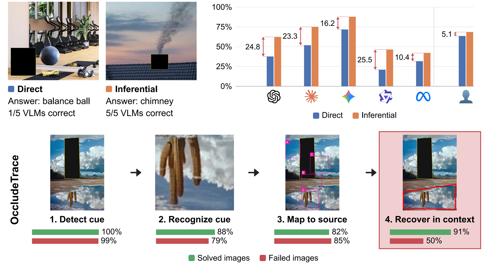

<div align="center">

# OccludeBench: Can VLMs Find What's Missing?

**Jasin Cekinmez**<sup>\*</sup> &nbsp; **Addison J. Wu**<sup>\*</sup> &nbsp; **Ryo Mitsuhashi**<sup>\*</sup> &nbsp; **Linrong Cai** &nbsp; **Xingyu Fu** &nbsp; **Zhuang Liu**

Princeton University &nbsp;·&nbsp; <sup>\*</sup>Equal contribution

[](https://huggingface.co/datasets/afs07fda89sdfas90/data)

</div>

<p align="center">
  
</p>

OccludeBench is a benchmark of 378 photographs, each with one object fully hidden behind a mask. In **direct** images (197) the object can only be recovered from its shadow or reflection; in **inferential** images (181) it can be inferred from the rest of the scene. Across five VLMs, accuracy averages 42.7% on direct images versus 62.7% on inferential ones, while humans show no significant gap. OccludeTrace, our four-stage diagnostic, finds that models detect and recognize the cue but fail to recover the object from it within the full image.

## Setup

```bash
git clone https://github.com/addisonwu05/OccludeBench
cd OccludeBench
pip install -r requirements.txt
cp .env.example .env   # then fill in your keys
```

| Variable | Provider |
|---|---|
| `OpenAI_API_KEY` | OpenAI (GPT-5.4, also a judge) |
| `Anthropic_API_KEY` | Anthropic (Claude Opus 4.6, also a judge) |
| `Gemini_API_KEY` | Google (Gemini 3.1 Pro) |
| `Together_API_KEY` | Together AI (Llama 4 Maverick, Qwen 3 VL 8B) |

Scripts read the benchmark from `data/combined_output/` (`annotations.json` plus `<id>.png`, `<id>_occluded.png`, `<id>_transparent.png`) and write results to `data/eval_results*/`.

## Running Experiments

Run everything from the repo root.

```bash
# Query all five models on the occluded and unmasked images
bash sec4_1_main_results/run_all_evals.sh
# or a single model
python sec3_occludebench/eval_script.py --model gpt-5.4

# Grade with both judges
python sec3_occludebench/judger_script.py --judge_models gpt-5.4 claude-opus-4-6
```

The other experiments have runner scripts in their own folders, and the notebooks rebuild the paper's tables and figures from the graded results.

## Repository Structure

```
sec3_occludebench/                  # §3 Benchmark
  eval_script.py                    # Main query: name the occluded object
  judger_script.py                  # Two-judge grading
  vetter_script.py                  # Follow-up when a response names the mask itself
  image_category_plots.ipynb        # Dataset distribution
  human_baseline/                   # Human baseline grading and analysis

sec4_1_main_results/                # §4.1 Main results
  run_all_evals.sh                  # Occluded and unmasked runs for all five models
  accuracy_breakdown_pub_quality.ipynb
  nudge_comparison.ipynb            # Base, thinking, tool use and steering accuracy
  localization_unmasked/            # Unmasked-box localization control
  category_accuracy/                # Per-category accuracy and chi-square tests
  human_model_correlation/          # Model vs. human per-image difficulty

sec4_2_why_vlms_fail/               # §4.2 OccludeTrace
  stage1_cue_detection/
  stage2_zoomed_recognition/        # app.py is the manual cropping tool
  stage3_source_mapping/
  stage4_highlighted_region/
  seeing_failure/  cue_removal/

sec4_3_improvements/                # §4.3 Interventions
  extended_reasoning/  tool_use/  coding_agents/  steering_prompts/  few_shot/
  inpainting_multistep/             # Inpaint-then-confront
  accuracy_improvements.ipynb       # Summary figure

appendix/                           # Box-style sensitivity, lexical metrics, token length,
                                    # image generation, human learning effects
```

## Citation

```bibtex
@misc{cekinmez2026occludebench,
  title={OccludeBench: Can VLMs Find What's Missing?},
  author={Cekinmez, Jasin and Wu, Addison J. and Mitsuhashi, Ryo and Cai, Linrong and Fu, Xingyu and Liu, Zhuang},
  year={2026}
}
```
